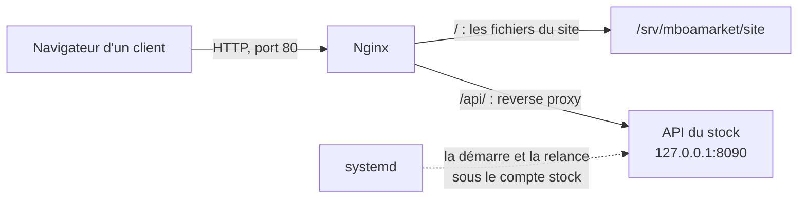

# Mboa Market — mise en production d'une boutique en ligne sur un serveur Linux

> La boutique en ligne de Mboa Market et son API du stock, en production sur Ubuntu : Nginx sert le site et protège l'API, systemd garde l'API en vie, et chaque compte n'a que les droits dont il a besoin. Avec le post-mortem d'un vrai incident de mise en production.


## Le contexte

Mboa Market est une boutique en ligne de Douala et de Montréal (une entreprise fictive). L'équipe de développement livre deux choses : le site de la boutique, et une petite API en Python qui donne le stock de chaque produit. Mon rôle, comme ingénieur DevOps : les mettre en production sur un serveur Linux, de façon sûre, et les garder en ligne.

Ce dépôt contient la configuration de ce serveur : avec lui, on reconstruit le serveur de zéro, et on voit ce qui a changé, quand, et pourquoi.

## Ce que j'ai mis en place

| Le besoin | Ce que j'ai fait | Dans ce dépôt |
|---|---|---|
| Une intégratrice met le site à jour sans être administratrice | le groupe `web`, son compte, et le dossier du site en `2775` (setgid) | — |
| Servir la boutique | Nginx, avec un site `mboamarket` et ses propres journaux | [`nginx/mboamarket`](nginx/mboamarket) |
| Garder l'API du stock en marche | un service systemd, sous un compte sans shell, relancé s'il tombe | [`systemd/mboa-stock.service`](systemd/mboa-stock.service) |
| Une seule adresse pour le site et l'API | Nginx en reverse proxy : `/api/` vers `127.0.0.1:8090` | [`nginx/mboamarket`](nginx/mboamarket) |
| Réparer une mise en production ratée | un 403 et un 502 : diagnostic, correction, post-mortem | [`docs/post-mortem-2026-11-08.md`](docs/post-mortem-2026-11-08.md) |

## Architecture



- Seul Nginx écoute sur le réseau (port 80). L'API n'écoute que sur `127.0.0.1` : on ne la joint qu'à travers Nginx.
- systemd démarre l'API avec la machine, et la relance si elle plante (`Restart=on-failure`).
- Les requêtes vers l'API passent par Nginx ce qui la sécurise des attaques externes.
## La sécurité

- L'API tourne sous le compte système `stock`, sans shell ni sudo : si elle est piratée, l'attaquant n'a presque aucun droit.
- Les intégrateurs du groupe `web` modifient le site sans être administrateurs, et personne d'autre ne peut y écrire.
- Nginx lit le site sans pouvoir le modifier.
- Ce dépôt ne contient ni mot de passe, ni clé, ni l'adresse IP du serveur.

## Structure du dépôt

```text
mboa-market-serveur/
├── README.md                        ce fichier
├── nginx/
│   └── mboamarket                   le site Nginx (dans /etc/nginx/sites-available/)
├── systemd/
│   └── mboa-stock.service           le service de l'API (dans /etc/systemd/system/)
└── docs/
    └── post-mortem-2026-11-08.md    l'incident de la version de novembre
```

## Installer sur un serveur

Il faut un serveur Ubuntu 24.04, un compte avec `sudo`, et le code livré par l'équipe de développement dans `/srv/mboamarket` : le site dans `site/`, l'API dans `stock/`.

```bash
git clone git@github.com:<ton-compte>/mboa-market-serveur.git
cd mboa-market-serveur

# Le dossier du site, pour l'équipe web
sudo groupadd web
sudo chown root:web /srv/mboamarket/site
sudo chmod 2775 /srv/mboamarket/site

# Le serveur web
sudo apt install -y nginx
sudo cp nginx/mboamarket /etc/nginx/sites-available/mboamarket
sudo ln -s /etc/nginx/sites-available/mboamarket /etc/nginx/sites-enabled/
sudo rm /etc/nginx/sites-enabled/default
sudo nginx -t && sudo systemctl reload nginx

# L'API du stock, en service
sudo useradd --system --no-create-home --shell /usr/sbin/nologin stock
sudo cp systemd/mboa-stock.service /etc/systemd/system/
sudo systemctl daemon-reload
sudo systemctl enable --now mboa-stock
```

Pour donner la main sur le site à un intégrateur : `sudo usermod -aG web <son-compte>`.

## Vérifier que tout marche

```bash
curl -I http://localhost/              # 200 : la boutique
curl -I http://localhost/promo.html    # 200 : la page des promotions
curl http://localhost/api/stock        # le stock, en JSON, à travers Nginx
systemctl status mboa-stock            # active (running)
sudo tail -n 3 /var/log/nginx/mboamarket.access.log
```
```text
HTTP/1.1 200 OK
Server: nginx/1.24.0 (Ubuntu)
Date: Sat, 14 Nov 2026 18:57:06 GMT
Content-Type: text/html
Content-Length: 1974
Last-Modified: Sat, 14 Nov 2026 15:28:45 GMT
Connection: keep-alive
ETag: "6af87e2d-7b6"
Accept-Ranges: bytes

HTTP/1.1 200 OK
Server: nginx/1.24.0 (Ubuntu)
Date: Sat, 14 Nov 2026 18:57:06 GMT
Content-Type: text/html
Content-Length: 1310
Last-Modified: Sat, 14 Nov 2026 15:28:45 GMT
Connection: keep-alive
ETag: "6af87e2d-51e"
Accept-Ranges: bytes

{"version": "novembre", "produits": [{"id": "poivre-penja", "nom": "Poivre de Penja", "stock": 42}, {"id": "cafe-ouest", "nom": "Café de l'Ouest", "stock": 18}, {"id": "miel-oku", "nom": "Miel blanc d'Oku", "stock": 7}, {"id": "sirop-erable", "nom": "Sirop d'érable", "stock": 0}, {"id": "pagne-wax", "nom": "Pagne wax", "stock": 25}]}
● mboa-stock.service - API du stock de Mboa Market
     Loaded: loaded (/etc/systemd/system/mboa-stock.service; enabled; preset: e>
     Active: active (running) since Sat 2026-11-14 17:28:23 CET; 2h 28min ago
   Main PID: 110141 (python3)
      Tasks: 1 (limit: 9483)
     Memory: 9.4M (peak: 13.3M)
        CPU: 2.494s
     CGroup: /system.slice/mboa-stock.service
             └─110141 /usr/bin/python3 /srv/mboamarket/stock/stock.py
lines 1-9/9 (END)
127.0.0.1 - - [14/Nov/2026:19:57:06 +0100] "HEAD / HTTP/1.1" 200 0 "-" "curl/8.5.0"
127.0.0.1 - - [14/Nov/2026:19:57:06 +0100] "HEAD /promo.html HTTP/1.1" 200 0 "-" "curl/8.5.0"
127.0.0.1 - - [14/Nov/2026:19:57:06 +0100] "GET /api/stock HTTP/1.1" 200 338 "-" "curl/8.5.0"

```

## L'incident du 8 novembre 2026

Juste après la publication de la version de novembre, la page des promotions répondait **403** et l'API du stock **502**.

- **Le 403** : l'outil mboa-publier s'exécute en root avec sudo et contient umask 077 (« les fichiers de la livraison restent privés pendant la copie »)
- **Le 502** :  l'unité systemd mboa-stock.service ne définissait pas STOCK_FICHIER, que la nouvelle version de l'API exige. L'API plantait donc dès son démarrage.

Le diagnostic, la chronologie, la correction et les actions pour que ça ne revienne pas sont dans le [post-mortem](docs/post-mortem-2026-11-08.md).

## Ce que j'ai appris


### 1. Comptes, groupes et permissions
- Créer un compte avec son groupe (`useradd -m -s /bin/bash -G web nadia`) et préparer un dossier partagé pour une équipe.
- Le **SGID** (`2775`) fait hériter le groupe aux nouveaux fichiers, mais ne règle pas leurs droits.
- Le **umask** décide des droits à la création : `0002` pour mon compte, `0022` sous sudo, `077` dans `mboa-publier`, ce qui a causé l'incident.
- Un service a son propre compte système (`useradd --system`, `nologin`, sans dossier personnel) : c'est le principe du **moindre privilège**.

### 2. Nginx
- Installer Nginx et vérifier qu'il tourne : `systemctl status`, `ss -tlnp`, `curl -I`.
- Un `active (running)` ne prouve pas que le service écoute : il faut vérifier le port.
- Écrire un bloc `server` (racine, journaux séparés), l'activer par un lien symbolique dans `sites-enabled`, puis tester avec `nginx -t` avant le `reload`.
- Deux `default_server` sur le même port provoquent une erreur de configuration.
- Seul le processus maître tourne en root ; les workers tournent en `www-data`.
- Utiliser Nginx comme **reverse proxy** devant l'API (`proxy_pass`).

### 3. systemd
- Transformer un script lancé à la main en **service** : fichier d'unité, `daemon-reload`, `enable --now`.
- Prouver que `Restart=on-failure` fonctionne : `kill -9` sur le processus, puis lecture de `journalctl -u`.
- Les variables d'environnement se déclarent dans l'unité (`Environment=`).
- Une relance automatique ne répare pas une erreur qui se reproduit à chaque démarrage : systemd finit par abandonner (« Start request repeated too quickly »).

### 4. Diagnostic d'incident
Méthode : **symptôme → journal → cause → correction → vérification**.

### 5. Documentation
- Tenir un journal de bord reproductible : chaque commande avec son résultat.
- Rédiger un **post-mortem sans coupable** : impact, chronologie datée, causes racines, correction, actions de prévention avec responsables.

## Auteur

Saïd mounpain [suivez mois sur linkedIn] (www.linkedin.com/in/mounpainsaid) — formation « Devenir Ingénieur DevOps » de Runbookly, atelier du 8 novembre 2026.
